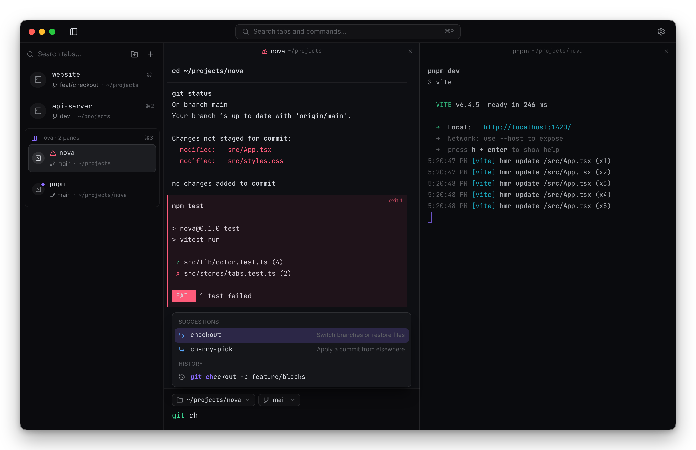
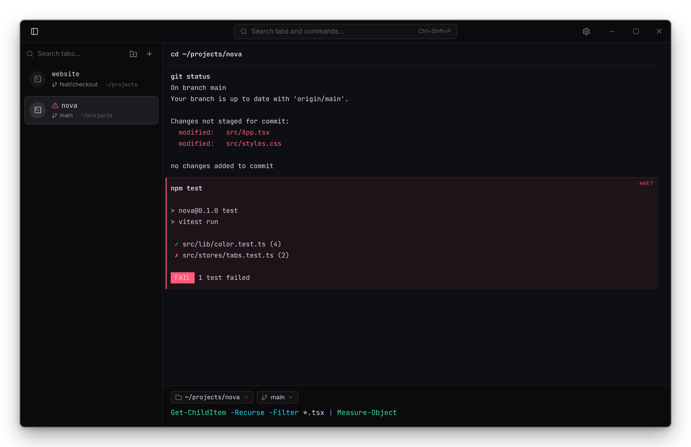
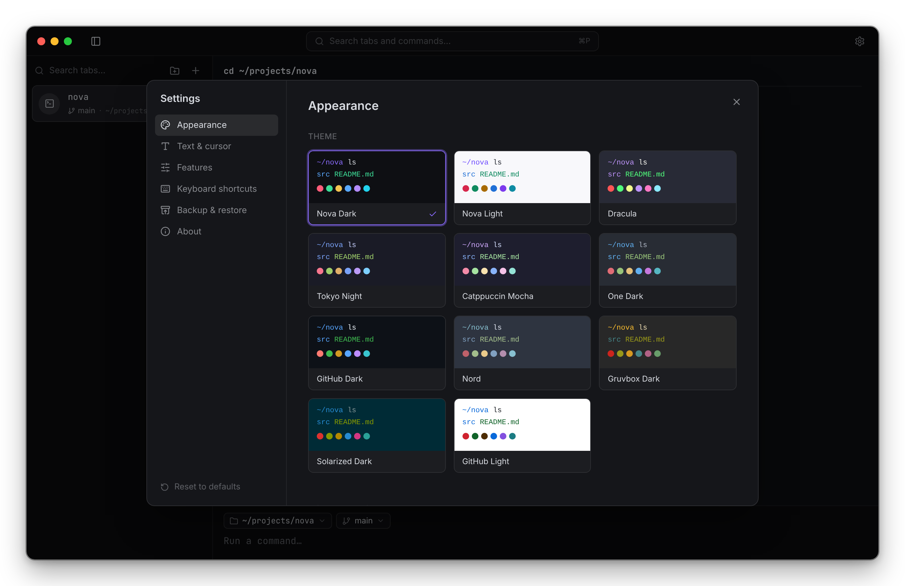
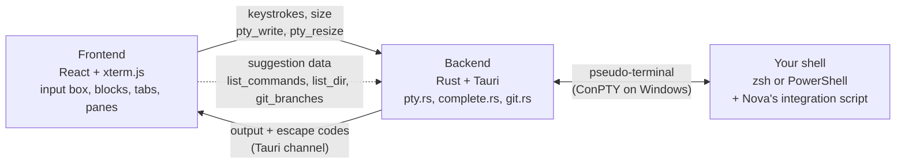

<div align="center">


# Nova Terminal

**A fast, modern terminal for macOS and Windows.**<br>
Command blocks, vertical tabs, split panes, and an input box that knows your shell.

[](https://github.com/umeshbakotiyadev/nova-terminal/actions/workflows/ci.yml)
[](#license)
[](#download)
[](https://v2.tauri.app)

[Download](#download) ·
[Build from source](#build-from-source) ·
[Contributing](CONTRIBUTING.md) ·
[Roadmap](docs/ROADMAP.md)

<br>



</div>

> [!NOTE]
> Nova is young (v0.1). macOS is the main platform. Windows support is new and hasn't had much testing on real machines yet, so bug reports from Windows users are especially welcome.

## Features

- **Command blocks.** Each command and its output form one block. Failed commands get a red edge and their exit code, and a divider marks where a command that's still running begins.
- **An input box that knows your shell.** At the prompt you type into a real editor: multi-line commands, syntax colouring, unknown commands underlined, and ⌥⇧F to split a long pipeline onto readable lines.
- **Suggestions as you type.** Commands on your PATH, subcommands and flags with descriptions for 60+ tools (git, npm, pnpm, docker, cargo, kubectl, gh and more), files and folders, git branches, `package.json` scripts, and matching commands from your history. A grey ghost suggestion completes the line with →.
- **Vertical tabs.** Every tab shows its folder, git branch, a dot while something runs and a warning when the last command failed. Drag to reorder, double-click to rename. Split tabs show as a group.
- **Split panes.** ⌘D splits right, ⌘⇧D splits down. Drag dividers to resize; layouts come back when you reopen Nova.
- **Folder and branch chips.** Click the folder chip to jump to a parent, child or recent folder; click the branch chip to switch or create a git branch.
- **Command palette** (⌘P) for tabs, themes and actions.
- **11 themes** and settings for font, size, line height, cursor, window opacity and background blur, all applied instantly. Animations are subtle and can be turned off; macOS Reduce Motion is respected.
- **Backup and restore.** Export settings, tabs with their split layouts, history and recent folders to one file and load it on another computer.
- **Built for heavy output.** Output is batched and back-pressured, so floods of logs stay smooth, memory stays flat and ⌃C works straight away. Rendering uses WebGL.
- **Private.** No account, no telemetry. Settings and history stay on your computer.

<table>
  <tr>
    <td width="50%"></td>
    <td width="50%"></td>
  </tr>
  <tr>
    <td align="center">Windows, with PowerShell</td>
    <td align="center">Themes and settings</td>
  </tr>
</table>

## Download

| System | Download |
| --- | --- |
| macOS 11 or later, Apple Silicon (M1 and newer) | [**Nova-Terminal_aarch64.dmg**](https://github.com/umeshbakotiyadev/nova-terminal/releases/latest/download/Nova-Terminal_aarch64.dmg) |
| macOS 11 or later, Intel | [**Nova-Terminal_x64.dmg**](https://github.com/umeshbakotiyadev/nova-terminal/releases/latest/download/Nova-Terminal_x64.dmg) |
| Windows 10 and 11 (64-bit) | [**Nova-Terminal_x64-setup.exe**](https://github.com/umeshbakotiyadev/nova-terminal/releases/latest/download/Nova-Terminal_x64-setup.exe) or [.msi](https://github.com/umeshbakotiyadev/nova-terminal/releases/latest/download/Nova-Terminal_x64.msi) |

These links always fetch the latest version. Release notes and older versions are on the [Releases page](https://github.com/umeshbakotiyadev/nova-terminal/releases). Not sure which Mac you have? Apple menu → **About This Mac**: "Apple M…" means Apple Silicon, "Intel" means Intel.

The builds aren't code-signed yet, so your system asks once before opening Nova:

- **macOS:** if Nova won't open, go to **System Settings → Privacy & Security** and click **Open Anyway**. Or run `xattr -dr com.apple.quarantine "/Applications/Nova Terminal.app"`.
- **Windows:** when SmartScreen appears, click **More info → Run anyway**.

You can also [build Nova yourself](#build-from-source).

## Build from source

### Prerequisites

| | macOS | Windows |
| --- | --- | --- |
| System tools | Xcode Command Line Tools: `xcode-select --install` | [Visual Studio C++ Build Tools](https://visualstudio.microsoft.com/visual-cpp-build-tools/) ("Desktop development with C++"); WebView2 comes with Windows 10 and 11 |
| Rust (stable) | [rustup.rs](https://rustup.rs) | `winget install Rustlang.Rustup` |
| Node.js 22 | `brew install node@22` or `nvm install 22` | `winget install OpenJS.NodeJS.LTS` |
| pnpm 10 | `npm install -g pnpm` | `npm install -g pnpm` |

Tauri's [prerequisites guide](https://v2.tauri.app/start/prerequisites/) has more detail if something is missing.

### Run it

```bash
git clone https://github.com/umeshbakotiyadev/nova-terminal.git
cd nova-terminal
pnpm install
pnpm tauri dev
```

The first `pnpm tauri dev` compiles the Rust side and takes a few minutes. After that Nova starts in seconds and the UI reloads as you edit.

On macOS, `./scripts/setup.sh` checks the tools above and installs the packages in one go.

### Build an installer

```bash
pnpm tauri build
```

The result lands in `src-tauri/target/release/bundle/`: `dmg/` and `macos/` on macOS, `msi/` and `nsis/` on Windows.

### Useful commands

| Command | What it does |
| --- | --- |
| `pnpm tauri dev` | Run Nova with hot reload |
| `pnpm tauri build` | Build a release app and installer |
| `pnpm typecheck` | Type-check the frontend |
| `pnpm build` | Type-check and build the frontend into `dist/` |
| `cargo test` | Run the Rust tests (from `src-tauri/`) |
| `cargo fmt` / `cargo clippy` | Format and lint the Rust code (from `src-tauri/`) |

### Linux

Linux isn't supported yet. The code is cross-platform and may build with Tauri's Linux prerequisites, but nobody has tested it, and bash and fish don't have shell integration yet (they run as a classic terminal). Help here is very welcome; see the [roadmap](docs/ROADMAP.md).

## Keyboard shortcuts

On Windows, Nova's own shortcuts use **Ctrl+Shift** where macOS uses **⌘**, and add **Alt** where macOS adds **⇧**, so they never clash with shortcuts of programs running inside the terminal.

| Action | macOS | Windows |
| --- | --- | --- |
| New tab | ⌘T | Ctrl+Shift+T |
| Split pane right / down | ⌘D / ⌘⇧D | Ctrl+Shift+D / Ctrl+Shift+Alt+D |
| Close pane (or tab) | ⌘W | Ctrl+Shift+W |
| Next / previous pane | ⌘] / ⌘[ | Ctrl+Shift+] / Ctrl+Shift+[ |
| Go to tab 1–9 | ⌘1 … ⌘9 | Ctrl+Shift+1 … Ctrl+Shift+9 |
| Next / previous tab | ⌘⇧] / ⌘⇧[ or ⌃Tab / ⌃⇧Tab | Ctrl+Shift+Alt+] / Ctrl+Shift+Alt+[ or Ctrl+Tab / Ctrl+Shift+Tab |
| Command palette | ⌘P | Ctrl+Shift+P |
| Show / hide tabs panel | ⌘B | Ctrl+Shift+B |
| Settings | ⌘, | Ctrl+Shift+, |
| Clear terminal | ⌘K or ⌃L | Ctrl+Shift+K or Ctrl+L |
| Bigger / smaller / reset text | ⌘= / ⌘- / ⌘0 | Ctrl+Shift+= / Ctrl+Shift+- / Ctrl+Shift+0 |
| Copy / paste | ⌘C / ⌘V | Ctrl+Shift+C / Ctrl+Shift+V (Ctrl+C copies when text is selected) |
| Run command / new line | ⏎ / ⇧⏎ | Enter / Shift+Enter |
| Previous / next command | ↑ / ↓ | ↑ / ↓ |
| Show or accept suggestions | ⇥ | Tab |
| Accept grey suggestion | → | → |
| Format command | ⌥⇧F | Alt+Shift+F |
| Open link | ⌘click | Ctrl+click |

## How it works

Nova is a [Tauri 2](https://v2.tauri.app) app. A small Rust backend runs your shell in a pseudo-terminal, and a React frontend draws everything you see with [xterm.js](https://xtermjs.org).



1. Each pane calls `pty_spawn`. Rust opens a pseudo-terminal, starts your login shell in it and streams its output back over a Tauri channel. Output is batched, and reading pauses when the UI falls behind.
2. Keystrokes go back with `pty_write`; window size changes with `pty_resize`.
3. Nova's shell integration makes the shell print invisible escape codes around each prompt and command. The frontend reads them to know where the prompt is, when a command starts and ends, its exit code and the current folder. That powers the input box, blocks, tab names and chips.
4. Suggestion data (commands on your PATH, folder contents, git branches, `package.json` scripts, shell history) is read straight from disk by Rust, without running any processes.

### Shell integration

- **zsh** (the macOS default): Nova points `ZDOTDIR` at a small bootstrap folder in its app data. The bootstrap restores your own `ZDOTDIR`, loads your normal `.zshenv`, `.zprofile` and `.zshrc`, then adds hooks that send `OSC 133` (prompt and command marks with the exit code) and `OSC 7` (current folder).
- **PowerShell** (the Windows default; PowerShell 7 if installed, otherwise Windows PowerShell 5.1): Nova starts it with `-NoExit` and a command that loads `nova.ps1` after your profile. The script is read as text, so it works even when the execution policy blocks scripts. It sends the same marks, hooks PSReadLine to report each command as it starts, and shares your aliases, functions and cmdlets for suggestions.
- **Other shells** run as a classic terminal for now.

The integration scripts live in [`src-tauri/shell-integration/`](src-tauri/shell-integration). Because Nova draws its own prompt chips, the shell's prompt is hidden while integration is active.

## Project layout

```
src/                    Frontend (React + TypeScript)
  components/           Title bar, tabs panel, panes, terminal view, input box, palette, settings
  completion/           Shell lexer, command specs, suggestion engine, syntax colouring, formatter
  stores/               Tabs, layout and settings state (Zustand)
  lib/                  PTY bridge, shortcuts, paths, platform rules, appearance, backup
  themes/               Terminal colour themes
src-tauri/              Backend (Rust)
  src/pty.rs            Shell sessions: spawn, stream output, write, resize, pause, kill
  src/shell.rs          Installs the shell integration scripts
  src/complete.rs       Suggestion data: commands on PATH, folders, branches, scripts, history
  src/git.rs            Current git branch for a folder, without running git
  src/menu.rs           Native macOS menu bar
  src/window_fx.rs      Adjustable background blur on macOS
  src/clipboard.rs      Native clipboard read for the right-click Paste
  src/files.rs          Reading and writing backup files
  shell-integration/    zsh and PowerShell scripts
  capabilities/         What the frontend is allowed to call
  tauri.conf.json       App config (tauri.windows.conf.json adds Windows overrides)
docs/                   Roadmap and screenshots
```

## Contributing

Contributions are welcome, from bug reports to new features. Start with [CONTRIBUTING.md](CONTRIBUTING.md); it covers setup, how the code is organised and what makes a pull request easy to merge. Good places to help right now:

- Testing on Windows 10 and 11 and reporting what breaks
- Shell integration for bash and fish
- Getting the Linux build working
- Anything on the [roadmap](docs/ROADMAP.md)

Please follow the [Code of Conduct](CODE_OF_CONDUCT.md). To report a security problem, see [SECURITY.md](SECURITY.md) rather than opening a public issue.

## Acknowledgements

Nova stands on the shoulders of [Tauri](https://tauri.app), [xterm.js](https://xtermjs.org), [portable-pty](https://crates.io/crates/portable-pty) from the WezTerm project, [React](https://react.dev), [Zustand](https://github.com/pmndrs/zustand), [Framer Motion](https://motion.dev), [Tailwind CSS](https://tailwindcss.com), [Lucide](https://lucide.dev) icons, and the [Inter](https://rsms.me/inter/) and [JetBrains Mono](https://www.jetbrains.com/lp/mono/) fonts.

## License

Nova Terminal is licensed under either of

- [Apache License, Version 2.0](LICENSE-APACHE)
- [MIT license](LICENSE-MIT)

at your option.

Unless you explicitly state otherwise, any contribution intentionally submitted for inclusion in Nova Terminal by you, as defined in the Apache-2.0 license, shall be dual licensed as above, without any additional terms or conditions.
